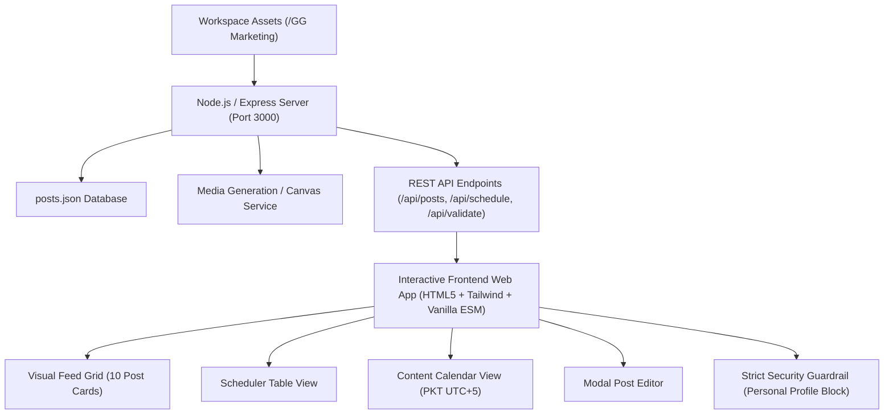

# Girlies Glow Social Media Content Scheduler & Preview Dashboard Design Spec

## 1. Executive Summary & Brand Identity
This design specification defines the architecture, data structures, media pipeline, safety guardrails, and interactive user interface for the **Girlies Glow Social Media Content Scheduler**.

### Brand Attributes & Standards:
- **Brand Name**: Girlies Glow
- **Tagline**: *"Skin That Speaks Softly"*
- **Target Market**: Pakistan & South Asia (girls and young women)
- **Hero Product**: Eco-friendly wheat-straw curved facial razor for at-home facial shaving / dermaplaning
- **Product Aesthetics**: Cream / off-white razor body with natural beige/brown wheat-straw speckles, ergonomic curved handle with oval thumb recess, cream blade housing, silver stainless-steel micro-guard blade, and transparent protective cap.
- **Physical Fidelity Rule**: The physical razor itself is NEVER recolored purple. Purple is reserved strictly for graphic backgrounds, frames, accents, and brand styling.
- **Price**: Rs. 599 (Single razor)
- **Mandatory Payment Term**: Cash on Delivery (COD) is available across Pakistan and MUST be stated in every conversion CTA.
- **Brand Palette**:
  - `#683DA9` (Wordmark Purple)
  - `#9B60E0` (Light Orchid)
  - `#8A54CC` (Amethyst)
  - `#5E389D` (Deep Plum)
  - `#65AA3F` (Leaf Green — Accent)
  - `#FFFFFF` (Clean White)
- **Voice & Tone**: Feminine, Gen Z, warm, relatable, confidence-building, authentic UGC, natural skin textures, blend of English and natural Roman Urdu. Strictly avoids unsupported medical/dermatological claims.

---

## 2. Platform Destinations & Strict Safety Guardrails

### 2.1 Destinations
- **Instagram**: Girlies Glow Instagram (`@girli_esglow`)
- **Facebook**: Girlies Glow Facebook BUSINESS PAGE

### 2.2 Hard Security Constraint
> [!CAUTION]
> **Zero Personal Profile Publishing Rule**: Under NO circumstances may any post be published or scheduled to Sannaya Mughal's personal Facebook profile.

### 2.3 Automated Guardrail Validation
Before any post can be moved to `Scheduled` status (individually or via `SCHEDULE ALL`), the system executes a destination check:
```typescript
function validateDestinations(post: Post): { isValid: boolean; error?: string } {
  if (post.destinations.facebookPage.includes("personal") || 
      post.destinations.facebookPage.toLowerCase().includes("sannaya")) {
    return {
      isValid: false,
      error: "Facebook destination is personal profile. Select Girlies Glow Facebook Page."
    };
  }
  if (!post.destinations.facebookPage.toLowerCase().includes("girlies glow")) {
    return {
      isValid: false,
      error: "Facebook destination must be the official Girlies Glow Facebook Page."
    };
  }
  return { isValid: true };
}
```
If an invalid target is detected:
1. Status transition is blocked.
2. The user interface triggers a high-visibility alert banner:
   **"Facebook destination is personal profile. Select Girlies Glow Facebook Page."**
3. Scheduling is locked until the destination is corrected to the verified Business Page.

---

## 3. 10-Post Content Calendar & Creative Specifications

### Schedule Strategy (PKT / UTC+5)
- **Start Date**: September 29, 2026
- **End Date**: October 8, 2026
- **Frequency**: Daily release strategically scheduled during peak engagement hours (primarily 6:30 PM – 8:30 PM PKT).
- **Rhythm**: Static → Reel → Carousel → Static → Reel → Static → Reel → Carousel → UGC → Conversion.

---

### Detailed Post Registry

#### **Post 1: Myth Buster**
- **Date & Time**: September 29, 2026 at 8:00 PM PKT
- **Format**: Static Feed Creative (4:5, 1080 × 1350 px)
- **Angle**: Facial shaving does not make hair grow back thicker.
- **Source Assets**: `Card 1.png` + `GirliesGlow_Logo_NoBG.png`
- **On-Image Hook**:
  - *"Facial shave karne se baal motay ho jayenge?"*
  - *"NOPE. Just a myth! 💜"*
  - Badge: *"Rs. 599 | COD Available 🇵🇰"*
- **Instagram Caption**:
  > “Facial shave karne se baal motay ho jayenge?” 👀
  >
  > Girl, this myth needs to GO. 💜
  >
  > Facial shaving removes peach fuzz from the surface. It doesn't magically make your hair grow back thicker.
  >
  > ✨ Smooth-looking skin
  > 💄 Smoother makeup application
  > 💜 Easy at-home routine
  >
  > Girlies Glow Facial Razor — Rs. 599
  > 🚚 Cash on Delivery available across Pakistan.
  >
  > #GirliesGlow #FacialRazor #DermaplaningPakistan #GlowAtHome #PakistaniGirls
- **Facebook Caption**:
  > “Facial shave karne se baal motay ho jayenge?” 👀
  >
  > Girl, this myth needs to go! 💜
  >
  > Facial shaving only removes peach fuzz and surface dead skin from the topmost layer of your skin. It has zero impact on follicle thickness or hair texture.
  >
  > ✨ Smooth, glowing skin in minutes
  > 💄 Flawless, cake-free makeup application
  > 🌿 Eco-friendly wheat-straw handle
  >
  > Get your Girlies Glow Facial Razor for just Rs. 599.
  > 🚚 Cash on Delivery available across Pakistan. Order via link in bio or send us a message!
- **Status**: Draft

---

#### **Post 2: Product in Action**
- **Date & Time**: September 30, 2026 at 7:30 PM PKT
- **Format**: Vertical Reel (9:16, 1080 × 1920 px)
- **Duration**: 10–15 seconds
- **Angle**: Close-up dermaplaning demonstration on cheek.
- **Source Assets**: `WhatsApp GIF 2026-09-11 at 00.01.06.gif`
- **Video Timing & Overlay Text**:
  - 0–2 sec: Close-up cheek / peach fuzz (*"Face shave karne se baal mote ho jate hain? 👀"*)
  - 2–7 sec: Cream wheat-straw razor gently used on taut cheek, peach fuzz visibly lifting.
  - 7–10 sec: Smooth glowing skin (*"Nope. That's a myth 💜"*)
  - 10–15 sec: Product end frame (*"Smooth skin at home ✨ | Rs. 599 | COD Available 🇵🇰"*)
- **Instagram Caption**:
  > “Face shave karne se baal mote ho jayenge?” 👀
  >
  > No girl, that’s a myth. 💜
  >
  > Girlies Glow Facial Razor removes peach fuzz and surface dead skin for a smoother, makeup-ready feel. ✨
  >
  > No salon appointment. Just glow at home. 💅
  >
  > Rs. 599
  > 🚚 Cash on Delivery available across Pakistan.
  >
  > #GirliesGlow #FacialRazor #DermaplaningPakistan #PeachFuzz #PakistaniGirls
- **Facebook Caption**:
  > Watch the glow happen in real time ✨
  >
  > No salon trips, no painful waxing, no waiting. Just light, gentle strokes with our wheat-straw facial razor.
  >
  > 💜 Removes peach fuzz + dead skin cells
  > 💜 Painless & beginner-friendly
  > 💜 Only Rs. 599 with Cash on Delivery nationwide!
  >
  > #GirliesGlow #BeautyHacks #PakistaniSkincare #SmoothSkin

---

#### **Post 3: Makeup Benefits**
- **Date & Time**: October 1, 2026 at 6:30 PM PKT
- **Format**: Multi-Slide Carousel (4:5, 1080 × 1350 px per slide, 4 slides)
- **Angle**: Why makeup sits better on dermaplaned skin.
- **Source Assets**: `Section 3.png`, `Card 4.png`, `car5.png`, `Single.png`
- **Slide Breakdown**:
  - **Slide 1**: *"Why isn't my makeup sitting smooth? 👀 (Swipe to see 👉)"*
  - **Slide 2**: Close-up skin texture with foundation: *"Peach fuzz can trap powder and affect how your base sits."*
  - **Slide 3**: Razor gently gliding: *"Remove the fuzz. Keep the glow. ✨ Safe, gentle, micro-guarded blade."*
  - **Slide 4**: Glowing, seamless finish + product photo: *"Your base just found its new bestie 💜 Rs. 599 | COD Available"*
- **Instagram Caption**:
  > Ever wondered why your foundation looks patchy or textured even after skin prep? 👀
  >
  > It’s often the peach fuzz trapping your foundation and powder! Swipe through to see how one quick dermaplaning session transforms your base. ✨
  >
  > 💜 Makeup glides on effortlessly
  > 💜 No cakey patches
  > 💜 Gentle & eco-friendly handle
  >
  > Rs. 599 | Cash on Delivery Available across Pakistan 🇵🇰
  >
  > #GirliesGlow #FlawlessBase #PakistaniBeauty #MakeupHacks #Dermaplaning

---

#### **Post 4: Salon vs. Home**
- **Date & Time**: October 2, 2026 at 8:15 PM PKT
- **Format**: Static Comparison (4:5, 1080 × 1350 px)
- **Angle**: Convenience & cost comparison.
- **Source Assets**: Split-screen design using `Single.png` & `pair .png`
- **Visual Structure**:
  - **Left (Salon)**: Salon appointment, travel in traffic, waiting lounge, repeated monthly costs (Rs. 2000+).
  - **Right (Girlies Glow)**: At home in your pajamas, takes 5 minutes, painless, eco-friendly.
  - **Hook**: *“Parlour jaane ka mood nahi?” 💅*
  - **CTA**: *“Glow ghar par. Rs. 599 | COD Available 🇵🇰”*
- **Instagram Caption**:
  > Traffic mein phansna, parlour ki waiting, aur har maheene wahi kharcha? 🙅‍♀️
  >
  > Parlour jaane ka mood nahi? Switch to Girlies Glow! 💅
  >
  > Instant glow, painless peach fuzz removal, aur complete salon-smooth feel — apne room ke comfort mein.
  >
  > ✨ Only Rs. 599
  > 🚚 Cash on Delivery available all over Pakistan!
  >
  > #GirliesGlow #SalonAtHome #GlowGharPar #PakistaniGirls #SmartBeauty

---

#### **Post 5: Relatable UGC Testimonial**
- **Date & Time**: October 3, 2026 at 7:45 PM PKT
- **Format**: Vertical Reel (9:16, 1080 × 1920 px)
- **Duration**: 15–20 seconds
- **Angle**: Relatable girl-to-camera conversation debunking fear.
- **Source Assets**: `WhatsApp GIF 2026-09-11 at 00.01.14.gif` + creator audio
- **Dialogue / Text Flow**:
  - *“Mujhe bhi lagta tha shave karungi toh baal mote ho jayenge…”*
  - Cut to gentle razor glide on cheek.
  - *“But that was literally the reason I kept avoiding facial shaving.”*
  - Cut to smooth cheek touch: *“Ab makeup kitna smooth lagta hai. 😭💜”*
  - End frame: Girlies Glow Facial Razor | Rs. 599 | COD Available Across Pakistan.
- **Instagram Caption**:
  > Raise your hand if you let the “hair will grow thicker” myth hold you back for years 🙋‍♀️😭
  >
  > Once you see how your skin feels and how smooth your tint and concealer look... there is NO going back! 💜
  >
  > Try the Girlies Glow wheat-straw razor for just Rs. 599.
  > 🚚 Cash on Delivery available nationwide!
  >
  > *(Creator-style showcase)*
  > #GirliesGlow #RelatableReels #PakistaniGirls #SkincareRoutine #DermaplaningPak

---

#### **Post 6: Product Benefits & Eco-Value**
- **Date & Time**: October 4, 2026 at 5:30 PM PKT
- **Format**: Static Feed Graphic (4:5, 1080 × 1350 px)
- **Angle**: Deep dive into why this razor is superior.
- **Source Assets**: `Single.png` hero photo on lavender pedestal with wheat stalks.
- **Visual Copy**:
  - Headline: *“Small razor. Big glow energy. ✨”*
  - Key Benefit Badges:
    - ✓ Removes peach fuzz gently
    - ✓ Micro-guard stainless blade (prevents nicks)
    - ✓ Biodegradable wheat-straw handle
    - ✓ Easy at-home use
    - ✓ Makeup-ready smoothness
  - CTA Badge: *“Rs. 599 | COD Available Across Pakistan 🇵🇰”*
- **Instagram Caption**:
  > Meet the little tool that changes everything in your beauty bag ✨
  >
  > It’s not just a razor — it’s your ticket to ultra-smooth skin and butter-soft makeup application:
  >
  > 🌾 Eco-friendly wheat-straw handle
  > 🛡️ Stainless-steel micro-guard blade (super beginner-safe!)
  > 🌸 Leaves skin baby soft without irritation
  >
  > Only Rs. 599 with Cash on Delivery across Pakistan 🚚
  >
  > #GirliesGlow #EcoBeauty #FacialRazor #PakistaniGirls #SkinCareHacks

---

#### **Post 7: GRWM Transformation**
- **Date & Time**: October 5, 2026 at 8:00 PM PKT
- **Format**: Vertical Reel (9:16, 1080 × 1920 px)
- **Duration**: 15–20 seconds
- **Angle**: Get Ready With Me routine showing the glow transition.
- **Source Assets**: `WhatsApp GIF 2026-09-11 at 00.01.24.gif`
- **Progression**:
  - Step 1: Bare skin — *“GRWM but first… peach fuzz has to go 👀”*
  - Step 2: Girlies Glow razor smoothing cheek & jawline.
  - Step 3: Hydrating serum & skin prep.
  - Step 4: Foundation blend with beauty sponge.
  - Step 5: Glass skin reveal — *“THAT smooth base ✨”*
  - End Frame: Girlies Glow Facial Razor — Rs. 599 | COD Available 🇵🇰
- **Instagram Caption**:
  > The secret to that glass-skin base? Prep starts BEFORE the skincare! ✨
  >
  > Removing peach fuzz allows your serums to absorb deeper and your base to melt straight into your skin. No cake, no texture, just pure glow. 💜
  >
  > Rs. 599 | Cash on Delivery across Pakistan.
  >
  > #GirliesGlow #GRWM #GlassSkin #MakeupTransformation #PakistaniGirls

---

#### **Post 8: How to Use (Beginner Guide)**
- **Date & Time**: October 6, 2026 at 7:00 PM PKT
- **Format**: Multi-Slide Educational Carousel (4:5, 1080 × 1350 px, 5 slides)
- **Angle**: Actionable step-by-step tutorial for beginners.
- **Source Assets**: `Section 1.png`, `card 3.png`, `Card 2.png`, `packaging section one.png`
- **Slides**:
  - **Slide 1**: *“New to facial shaving? Save this 💜 (Step-by-step guide 👉)”*
  - **Slide 2**: *“Step 1: Start with clean, dry skin or light facial oil.”*
  - **Slide 3**: *“Step 2: Hold skin gently taut with your free hand.”*
  - **Slide 4**: *“Step 3: Hold razor at a 45° angle. Use light, downward strokes.”*
  - **Slide 5**: *“Step 4: Clean your razor with alcohol, replace the protective cap, and moisturize! Ready for your glow? Rs. 599 | COD Available Across Pakistan.”*
- **Instagram Caption**:
  > Save this post for your next skincare night! 💜
  >
  > If you’re trying dermaplaning for the first time, keep it simple and gentle:
  > 1️⃣ Cleanse your face thoroughly
  > 2️⃣ Always hold your skin taut
  > 3️⃣ 45-degree angle, short downward strokes
  > 4️⃣ Follow up with your favorite moisturizer (skip active acids for 24h!)
  >
  > Get your eco-friendly razor for Rs. 599.
  > 🚚 Cash on Delivery available across Pakistan!
  >
  > #GirliesGlow #SkincareGuide #Dermaplaning101 #HowToGlow #PakistanBeauty

---

#### **Post 9: Creator UGC Review**
- **Date & Time**: October 7, 2026 at 7:30 PM PKT
- **Format**: Creator UGC Card (4:5, 1080 × 1350 px)
- **Angle**: Honest creator reflection and relief from debunking the myth.
- **Source Assets**: `Card 6.png` & `card7.png`
- **Visual Design**: Natural handheld phone photo aesthetic with speech bubbles:
  - *“I was SO scared my facial hair would come back thicker 😭”*
  - *“Turns out I was stressing over a myth.”*
  - *“Now I understand the hype around that smooth makeup base. 💜”*
  - Label: *Creator Showcase*
  - CTA: *“Try Girlies Glow — Rs. 599 | Cash on Delivery Available 🇵🇰”*
- **Instagram Caption**:
  > “I was SO scared my facial hair would come back thicker 😭 Turns out I was stressing over nothing!”
  >
  > Don't let old myths keep you from having the smoothest skin of your life. 💜
  >
  > Rs. 599 | Cash on Delivery available across Pakistan!
  > *(Creator-style showcase)*
  >
  > #GirliesGlow #CreatorReview #HonestBeauty #PakistaniCreators #GlowUp

---

#### **Post 10: Conversion / Special Offer**
- **Date & Time**: October 8, 2026 at 8:30 PM PKT
- **Format**: Static Conversion Creative (4:5, 1080 × 1350 px)
- **Angle**: Direct sales conversion with high visibility on price and COD.
- **Source Assets**: `packaging section one.png` + `Single.png` on sleek purple/white branded background.
- **Visual Copy**:
  - Headline: *“Ready to ditch the peach fuzz? ✨”*
  - Product: *Girlies Glow Facial Razor*
  - Highlighted Price: **Rs. 599** (in large, bold typography)
  - Highlighted COD Badge: **“CASH ON DELIVERY AVAILABLE ACROSS PAKISTAN 🇵🇰”**
  - CTA: *“Order yours today 💜 Tap the link in bio to shop!”*
- **Instagram Caption**:
  > Ready to ditch the peach fuzz and unlock glowing, baby-soft skin? ✨
  >
  > Get the Girlies Glow Eco-Friendly Facial Razor today for just Rs. 599!
  >
  > 📦 What you get:
  > ✓ Biodegradable wheat-straw curved handle
  > ✓ Stainless-steel micro-guard safety blade
  > ✓ Protective travel cap
  > 🚚 Cash on Delivery available all across Pakistan!
  >
  > 🛍️ Tap the link in our bio or DM us to order now!
  >
  > #GirliesGlow #ShopNow #DermaplaningPakistan #BeautyDeals #CashOnDelivery

---

## 4. Software Architecture & Implementation Plan

### 4.1 System Components


### 4.2 File Structure
```
/Users/sannayamughal/Projects/GG Marketing /
├── docs/superpowers/specs/2026-09-28-content-scheduler-design.md
├── package.json
├── server.js                        # Express backend, serves assets & handles persistence
├── data/
│   └── posts.json                   # Single source of truth for all 10 posts
├── public/
│   ├── index.html                   # Interactive dashboard frontend
│   ├── app.js                       # Frontend reactive logic & destination guards
│   ├── styles.css                   # Custom Girlies Glow brand styles & animations
│   └── generated/                   # Rendered 4:5, 9:16 and carousel graphics
├── scripts/
│   └── generate_creatives.js        # Media composite builder for all 10 posts
└── [User uploaded source assets: Single.png, Card 1.png, GIFs, etc.]
```

### 4.3 REST API Endpoints
- `GET /api/posts`: Returns all 10 posts with their media, captions, status, and destination metadata.
- `PUT /api/posts/:id`: Updates an individual post's caption, date, time, media, or status.
- `POST /api/posts/:id/approve`: Toggles approval state.
- `POST /api/posts/:id/schedule`: Runs destination validation. Fails with 400 error if destination is personal profile.
- `POST /api/posts/approve-all`: Sets all posts to `Approved`.
- `POST /api/posts/schedule-all`: Validates and schedules all approved posts.
- `POST /api/posts/:id/regenerate-media`: Triggers the creative generation engine to re-render graphics.
- `GET /api/export/:format`: Exports current schedule as `.csv` or `.json`.

---

## 5. Verification & Testing Criteria
1. **Visual Accuracy**:
   - Razor is strictly cream / wheat-straw with beige speckles.
   - Logo is intact and uncompressed.
   - Text overlays follow `#683DA9` and `#FFFFFF` brand colors.
2. **Platform Guardrail Test**:
   - Intentionally simulating a personal profile destination must trigger the required error:
     *"Facebook destination is personal profile. Select Girlies Glow Facebook Page."*
   - Validating Girlies Glow Facebook Business Page allows scheduling to proceed smoothly.
3. **Pacing & Timing**:
   - Dates span September 29 – October 8, 2026 daily in PKT.
   - Times are set for high-traffic evening hours.
4. **Interactive Action Suite**:
   - `EDIT` opens modal and saves changes reliably.
   - `APPROVE` updates status badge to Approved.
   - `REGENERATE MEDIA` generates fresh assets.
   - `SCHEDULE` validates and marks as Scheduled.
   - `APPROVE ALL` and `SCHEDULE ALL` work across all 10 posts.
